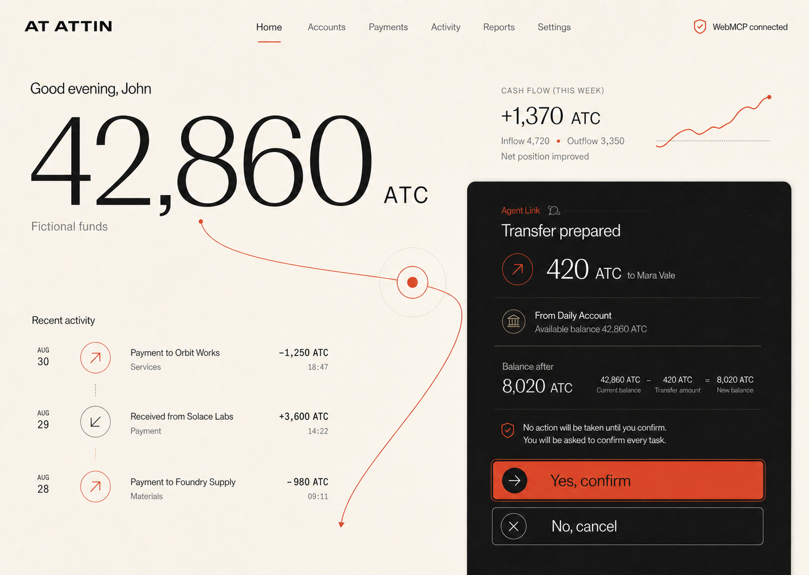

# At Attin

**A complete fictional-money bank where browser-native WebMCP can prepare any banking task, but only a human can approve it.**

At Attin is a single-user hackathon prototype for [The WebMCP Challenge](https://webmcp.devpost.com/). It is designed for older adults, younger users, first-time account holders, people with accessibility needs, and anyone who wants complex banking to feel understandable without surrendering control.

ATC is fictional, device-local money with no cash value. There are no real payment rails, bank connections, API keys, hosted models, or autonomous background actions.

## Try the prototype

- Deployed demo: [https://at-attin.astronebulae.chatgpt.site](https://at-attin.astronebulae.chatgpt.site)
- Username: `john.attin`
- Password: `attin2026`

The credentials are intentionally visible and prototype-only. A sign-in session remains in memory; the fictional banking state is versioned in the current browser's local storage.



## What works

- Home overview with 42,860 ATC, cash flow, recent activity, and a protected demo payment.
- Three accounts, transaction ledgers, statement views, and fictional receipts.
- Immediate, scheduled, and recurring payments with balance-floor protection.
- Payees, payment requests, retries, and schedule controls.
- Transaction search, filters, categories, notes, exports, and disputes.
- Card freeze, limits, merchant controls, online/contactless/travel settings, PIN reveal, lost-card reporting, and replacement.
- Reports, budgets, savings goals, subscriptions, and monthly planning.
- Fraud protection, support cases, alerts, trusted contact, accessibility settings, audit history, and reset.
- Responsive desktop, tablet, compact bottom navigation, keyboard focus, reduced motion, high contrast, and large text.

## WebMCP, not a built-in assistant

At Attin does not contain chat, an intent parser, a deterministic assistant engine, or a hosted LLM. The browser agent discovers structured capabilities directly through the experimental native `document.modelContext` API.

- **56 imperative tools** are registered with `document.modelContext.registerTool(...)` only after sign-in and a trusted human unlocks Agent Access.
- **Four declarative tools** annotate visible forms for transaction filtering, statement dates, report comparison, and audit filtering.
- Manual UI and WebMCP use the same domain operation service, validation, integer-money model, consequence preview, and atomic commit path.

See the [complete 60-tool catalogue](docs/webmcp-tool-catalog.md) and the [security boundary](docs/security-boundary.md). The implementation follows the [WebMCP Community Group draft](https://webmachinelearning.github.io/webmcp/) and Chrome's official guidance for the [imperative API](https://developer.chrome.com/docs/ai/webmcp/imperative-api), [declarative API](https://developer.chrome.com/docs/ai/webmcp/declarative-api), and [secure tools](https://developer.chrome.com/docs/ai/webmcp/secure-tools).

## The confirmation boundary

Every agent request—including every read—stops at an At Attin-owned confirmation surface before protected data is returned or state changes.

1. Validate closed, bounded arguments.
2. Prepare an exact disclosure or consequence preview without mutating state.
3. Bind one pending authorization to the operation digest and current state version.
4. Require a trusted, active human gesture on **Yes, confirm**. Critical actions also require typed uppercase `YES`.
5. Commit once, atomically; reject expiry, abort, cancellation, replay, duplicate, stale state, or invalid persistence.
6. Record a separate device-local agent audit outcome without making a read mutate banking state.
7. Serve the deployed UI with anti-framing and restrictive browser security headers so trusted confirmation clicks remain visible and app-owned.

The agent cannot unlock itself, approve itself, reuse approval, or bypass the application dialog.

## Hero evaluation prompts

In a WebMCP-capable browser, sign in, unlock Agent Access, and try:

1. “Summarize my August spending and show the biggest categories.”
2. “Create a monthly 1,250 ATC payment to Orbit Works starting September 1, but keep at least 5,000 ATC in Daily Account.”
3. “Secure the suspicious card charge: freeze the linked card and open a dispute.”

Each prompt must pause inside At Attin. Cancel one request, approve one normal request, and type lowercase `yes` before uppercase `YES` on the critical flow to see the safeguards.

## Run locally

Requirements: Node.js 22+ and pnpm.

```bash
pnpm install
pnpm dev
```

Quality gates:

```bash
pnpm test
pnpm run lint
pnpm run build
pnpm run test:sites
```

The production build emits `dist/client`, `dist/server/index.js`, and `dist/.openai/hosting.json` for Sites.

## Browser setup for WebMCP

Manual banking works in any current browser. Agent-driven banking requires an experimental browser build that exposes `document.modelContext` on the page origin. Follow that browser vendor's current WebMCP enablement instructions, reload At Attin, sign in, and unlock **Agent Access** with a direct human click. The status will change from **WebMCP unavailable** to **WebMCP ready** only when the native API is actually present.

The app never installs a substitute agent runtime. Tests use a `ModelContextFake` solely to verify the production registration and callback contract.

## Project map

- [Product and system specification](docs/superpowers/specs/2026-08-31-at-attin-design.md)
- [WebMCP tool catalogue](docs/webmcp-tool-catalog.md)
- [Security boundary](docs/security-boundary.md)
- [Three-minute demo script](docs/demo-script.md)
- [Design QA](design-qa.md)
- [Verification summary](outputs/verification-summary.md)
- Native registry: `src/webmcp/registry.ts`
- Confirmation coordinator: `src/webmcp/confirmation.ts`
- Secure bridge: `src/webmcp/bridge.ts`
- Shared banking operations: `src/domain/operations/`
- Imperative catalogue: `src/webmcp/catalog/`

## Known limitations

- WebMCP is experimental and unavailable in ordinary browsers that do not expose `document.modelContext`; At Attin truthfully shows that state and keeps manual banking functional.
- Authentication is deliberately hard-coded for one demo user and is not production identity security.
- All data is fictional and local to one browser profile; there is no server sync or recovery service.
- Simulated statements, receipts, notifications, support, and money requests never leave the device.
- This prototype does not claim banking, privacy, accessibility, or regulatory certification.

## License

MIT. See [LICENSE](LICENSE).
