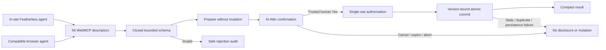

# At Attin WebMCP security boundary

## Purpose and threat model

At Attin uses fictional money, but it treats both the in-site Featherless agent and compatible browser agents as untrusted callers crossing a meaningful authorization and disclosure boundary. The design assumes an agent may send malformed, over-broad, stale, repeated, cancelled, or prompt-influenced requests. The agent may prepare work; only the present human may approve it.

The prototype does not claim production banking security. Its goal is to demonstrate a defensible WebMCP interaction contract where a real model can reason about complex banking tasks without gaining direct authority to disclose data or commit actions.

## Boundary overview

## Model boundary

- The Featherless API key exists only as a private Sites environment secret; it is never embedded in JavaScript, HTML, local storage, a model prompt, or a tool result.
- The browser calls only the same-origin `POST /api/agent` endpoint. Cross-origin requests, non-JSON requests, oversized bodies, unknown tools, malformed provider output, and missing secrets fail closed.
- The first model request contains the user's text plus public tool names, descriptions, and schemas—never balances, transactions, cards, payees, or `BankState`.
- Protected tool output is sent back to the model only after the user approves the matching At Attin confirmation.
- Provider output is untrusted. The client accepts only allowlisted tool names, revalidates arguments against the WebMCP schema, and delegates execution to `ToolBridge`.
- The model may request only one tool at a time, with a maximum of four individually confirmed steps per turn. It cannot unlock Agent Access, press confirmation controls, mint an approval, or execute in the background.

## Registration and lifecycle

- Production uses the native imperative callback shape `document.modelContext.registerTool(tool, { signal })`.
- No tools register before sign-in or while Agent Access is locked.
- Agent Access can change only through a trusted human activation in the application UI; no exposed tool can unlock it.
- One registry generation owns all 56 imperative registrations through one `AbortController`.
- Lock, logout, teardown, and failed partial registration abort the generation, unregister its tools, clear pending confirmation, and allow a clean later retry.
- The default same-origin boundary is preserved; the implementation does not use `exposedTo`.
- Four declarative tools remain visible forms. Their native activation and cancellation events are handled on `window`, filtered by exact `toolName`, and delegated to the same secure bridge.
- The production build embeds the real application shell in the Sites Worker, which applies repository-owned anti-framing, content-type, referrer, and feature-policy headers to every app route. The public root asset contains only an immediate `/login` redirect, so no confirmation or banking UI is exposed on the static-first path; `public/_headers` remains defense in depth for hosts that honor it.

## Argument validation

- Every imperative and declarative input schema is a distinct, closed object with `additionalProperties: false`.
- Identifiers, text, dates, money, array counts, and enum values are bounded.
- ATC input uses integer minor units with an upper bound; domain arithmetic never uses floating-point money.
- Structurally invalid input is rejected before a confirmation and records only a non-sensitive audit explanation.
- State-dependent validity is deliberately evaluated behind a generic confirmation request. An invalid account, goal, transaction, or insufficient amount cannot be probed for protected values before human approval.

## Prepare, confirm, commit

`ToolBridge` prepares one `ConfirmableAction` from the shared banking operation service. Preparation calculates disclosure and consequences without changing `BankState`.

`ConfirmationCoordinator` allows only one pending task. It binds a digest to:

- the prepared action ID;
- operation name;
- expected banking state version; and
- idempotency key.

The grant is created only after a trusted active user event. It expires after 90 seconds, is single-use, and is consumed synchronously against the prepared operation. Reads and mutations use the same boundary.

Critical actions—PIN reveal, lost/replacement cards, dispute initiation, suspicious-charge protection, and trusted-contact removal—also require typed uppercase `YES` plus the correct answer to a fresh single-digit addition check. Lowercase text, an absent or wrong answer, and programmatic approval are rejected while the prepared task remains pending.

## Fail-closed cases

No protected output or banking mutation occurs when any of these conditions is true:

- the request schema is invalid or over-broad;
- another task is already pending;
- the activation is synthetic or inactive;
- the user cancels or navigates away;
- Agent Access locks, the user signs out, or the app tears down;
- the tool callback's `AbortSignal` aborts;
- the 90-second window expires;
- the banking state version changed after preview;
- an idempotency key has already been consumed;
- persistence or post-reducer schema validation fails;
- a prior legacy scheduled payment has no recoverable confirmed floor;
- the Featherless secret is absent, the provider fails, or the model chooses an unknown or malformed tool call.

## Money and domain safeguards

- ATC is branded, fictional, and explicitly has no cash value.
- Account balances, payment amounts, budgets, goals, limits, and floors are integer minor units.
- Store reducers apply to a cloned candidate, validate the entire next state, persist it, and notify once only after success.
- Internal transfers, payments, goal funding, withdrawals, retries, and schedules enforce the maximum of the requested floor, configured account floor, and goal-backed reservation.
- Legacy actionable payments without a recoverable confirmed floor migrate fail-closed: recurring payments pause, one-off scheduled payments cancel, and failed retries remain inert until an explicit floor is reconfirmed.
- `secure_suspicious_charge` freezes the linked card and opens exactly one dispute in one atomic reducer, or performs neither action.

## Disclosure and prompt-injection handling

- Every read requires confirmation before data is returned.
- Read descriptors declare `readOnlyHint` only when they do not change banking state.
- Data that may contain user-controlled merchant, payee, memo, budget, goal, subscription, card-control, or audit text sets `untrustedContentHint`.
- Card reads use safe projections and never return the internal PIN hint.
- Free-form values stored by mutations are shown exactly in the confirmation preview.
- Tool output is compact JSON capped below 1,500 characters; larger results are deterministically bounded and summarized.

## Audit design

WebMCP outcomes use an append-only, device-local agent audit journal separate from the versioned banking state. This preserves the truth of `readOnlyHint` and prevents audit bookkeeping from making a confirmed read stale.

The bridge records begin and finish outcomes for completed, cancelled, expired, aborted, rejected, and recovery-pending attempts. Audit failures block new work or are explicitly surfaced; they are not silently reported as completed.

## Manual banking and accessibility

Manual banking remains available when WebMCP is absent or locked. Manual mutations use the same domain preparation and exact consequence renderer, followed by a direct human **Yes, confirm**; critical operations require `YES`.

The confirmation UI restores and traps focus, includes a visible cancel action, announces expiry and outcome, supports keyboard use, and respects large-text, high-contrast, reduced-motion, and system forced-motion preferences.

## Demo-only limitations

- The public credentials are intentionally hard-coded and are not suitable authentication.
- Local storage is not encrypted or synchronized.
- No real identity, bank, payment, support, email, or notification service is connected.
- Security properties are demonstrated and tested for the prototype; they are not a regulatory or production assurance.

## Source map

- `src/webmcp/registry.ts` — native lifecycle and cleanup
- `src/agent/runtime.ts` — in-site agent loop over the 56 WebMCP descriptors
- `src/components/AgentConsole.tsx` — accessible in-site conversation surface
- `worker/index.js` — same-origin, server-secret Featherless proxy and response validation
- `src/webmcp/schemas.ts` — closed bounded schemas
- `src/webmcp/bridge.ts` — validation, confirmation, output, and agent audit
- `src/webmcp/confirmation.ts` — trusted, expiring, single-use authorization
- `src/webmcp/audit.ts` — separate append-only agent journal
- `src/domain/store.ts` and `src/domain/schema.ts` — candidate validation and atomic persistence
- `src/domain/operations/` — shared prepare/commit banking operations
- `src/webmcp/webmcp-security.test.ts` and `src/test/webmcp-evals.test.ts` — security and hero evaluations

Official context: [WebMCP draft](https://webmachinelearning.github.io/webmcp/), [Chrome secure-tools guidance](https://developer.chrome.com/docs/ai/webmcp/secure-tools), and [Chrome WebMCP evals guidance](https://developer.chrome.com/docs/ai/webmcp/evals).
